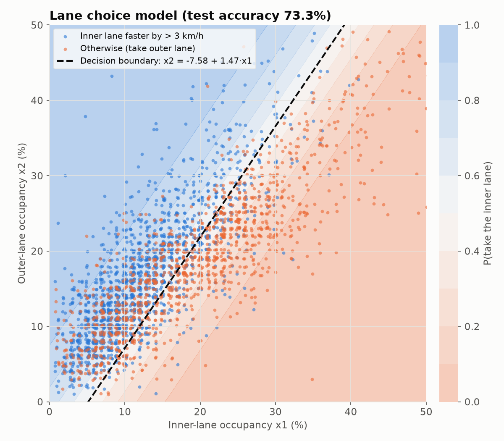
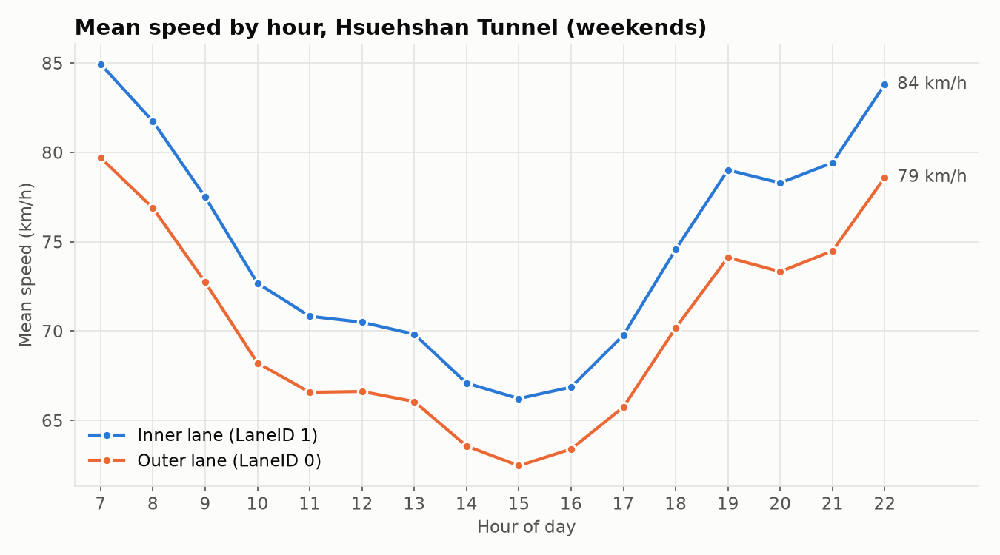

# Hsuehshan Tunnel Lane Choice Analysis

**English** | [繁體中文](README.zh-TW.md)

Which lane should you take into the Hsuehshan Tunnel? Lane changes are prohibited inside the 12.9 km tunnel on National Freeway 5 in Taiwan, so a driver picks a lane once, at the entrance. This project uses one year of open vehicle detector (VD) data to model when the inner lane is faster, using only the current occupancy of the two lanes.

Course project for *Computational Mathematics* (December 2025).



## Data

| | |
|---|---|
| Source | Freeway Bureau traffic database, VD live data (`VDLive`), [tisvcloud.freeway.gov.tw](https://tisvcloud.freeway.gov.tw/history/motc20/VD/) |
| Period | 2024-12-22 – 2025-12-21, weekends only (105 days), 07:00–22:59, one record every 15 minutes |
| Location | National Freeway 5, km 15.2 – 28.4 (the tunnel), both directions, 39 detectors |
| Size | 258,399 rows after parsing; 256,801 rows with both lanes present |
| Fields | `Time`, `VDID`, `Occupancy_0/1` (%), `Speed_0/1` (km/h) for LaneID 0 and 1 |

The parsed dataset is included as [`data/tunnel_data_final.csv.gz`](data/tunnel_data_final.csv.gz) (2 MB). The raw XML (about 1 GB for the weekend hours used) can be downloaded again with `00_download_data.py`; re-parsing it reproduces the CSV exactly.

**Which lane is the inner one?** The VD feed numbers lanes 0 and 1 but does not say which is the inner lane. LaneID 1 is faster 76% of the time (mean 74.6 vs 70.2 km/h) and has lower occupancy (16.3% vs 18.1%), as expected of the inner (passing) lane, so LaneID 1 is treated as the inner lane. This mapping is set in one place, `common.py`.



## Method

- **Label.** `Target = 1` (take the inner lane) when the inner lane is faster than the outer lane by more than 3 km/h; otherwise `Target = 0`.
- **Features.** Inner-lane occupancy *x*₁ and outer-lane occupancy *x*₂ (%), which a driver could see on a live traffic map.
- **Model.** Logistic regression, 80/20 random train/test split (`random_state=42`):

$$z = \beta_0 + \beta_1 x_1 + \beta_2 x_2, \qquad P(\text{inner lane}) = \frac{1}{1 + e^{-z}}$$

## Results

| Metric | Value |
|---|---|
| Test accuracy | **73.3%** |
| Majority-class baseline | 56.4% |
| Recall, inner / outer | 0.838 / 0.597 |
| F1, inner / outer | 0.780 / 0.661 |

| Coefficient | Value | Meaning |
|---|---|---|
| β₀ (intercept) | 1.1096 | With both lanes empty, P(inner) = 75.2% |
| β₁ (inner occupancy) | −0.2155 | Each +1% inner occupancy multiplies the odds of "inner" by 0.806 |
| β₂ (outer occupancy) | +0.1464 | Each +1% outer occupancy multiplies the odds of "inner" by 1.158 |

The decision boundary (P = 0.5) is **x₂ = −7.58 + 1.47·x₁**. Take the inner lane unless its occupancy exceeds roughly (x₂ + 7.6) / 1.47. For example, with the outer lane at 20%, the inner lane stays the better choice up to about 19% occupancy.

### Limitations

- The inner/outer mapping is inferred from the data, not from documentation.
- The random split mixes neighbouring 15-minute records and detectors between train and test, so the accuracy is probably optimistic. A split by date would be a stricter test.
- Two occupancy values explain only part of the speed difference. Hour of day, direction and detector position are obvious next features.

## Run it

```bash
pip install -r requirements.txt

python 02_train_model.py      # train and print metrics (uses the included CSV)
python 03_visualization.py    # write figures/*.png

# Optional: rebuild the dataset from raw XML
python 00_download_data.py    # weekends 07:00–22:45, ~6,700 files → data/vd_xml/
python 01_parse_xml.py        # → data/tunnel_data_final.csv.gz
```

## Project structure

```
├── 00_download_data.py     download VDLive XML from the Freeway Bureau archive
├── 01_parse_xml.py         filter tunnel detectors and lanes, write the CSV (multi-process)
├── 02_train_model.py       logistic regression, metrics and interpretation
├── 03_visualization.py     speed-by-hour and decision-boundary figures
├── common.py               paths, lane mapping, data loading, model fitting
├── data/
│   └── tunnel_data_final.csv.gz
└── figures/
```
