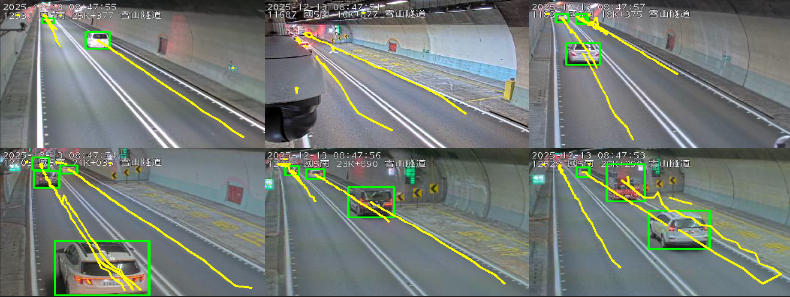
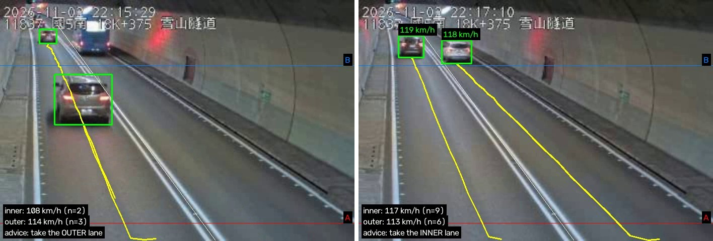
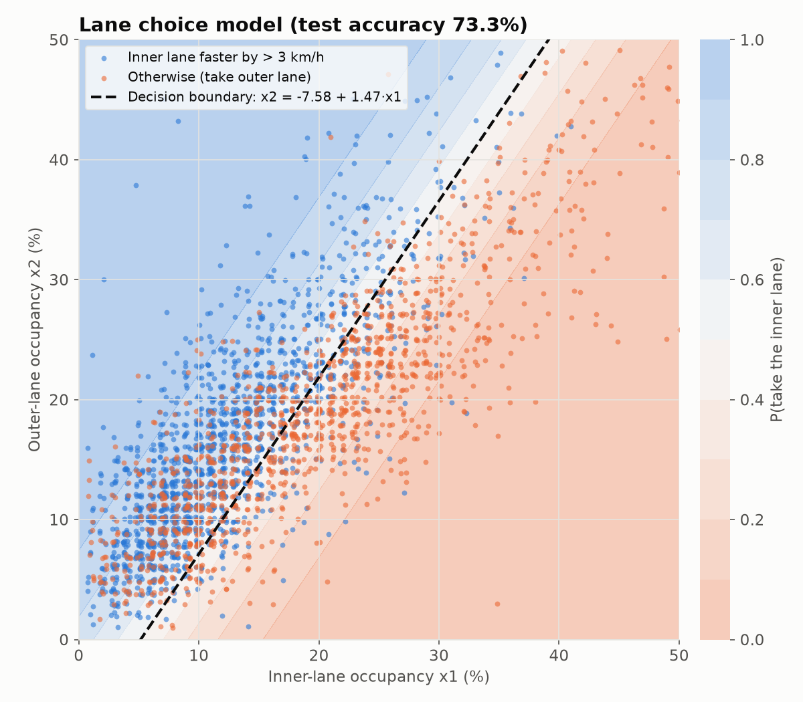
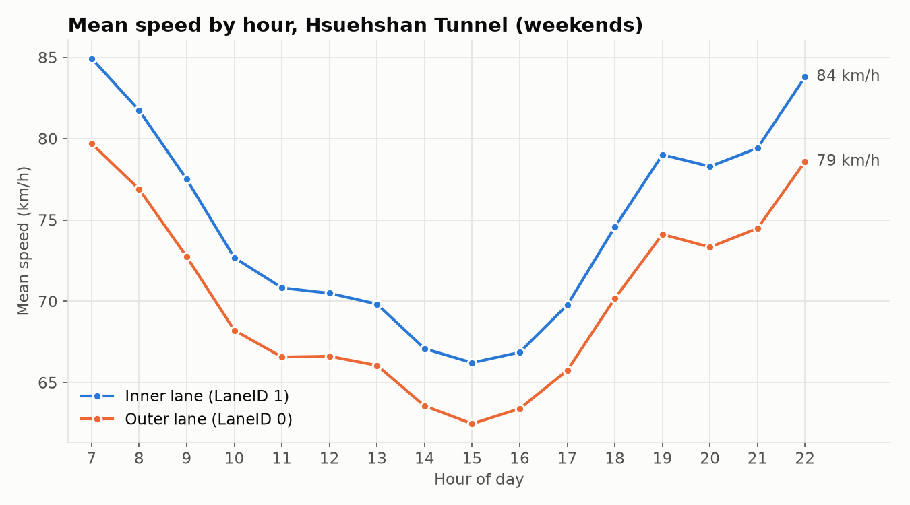

# 雪山隧道車道建議系統

[English](README.md) | **繁體中文**

進雪山隧道該走內側還是外側？國道 5 號雪隧全長 12.9 公里、隧道內禁止變換車道，駕駛只能在入口選一次。本專案從兩個資料來源分析雪隧車流：

1. **即時 CCTV**：以 YOLOv8 偵測、DeepSORT 追蹤隧道內公開監視器畫面中的車輛，用虛擬測速線量測每輛車的速度，再以車道分隔線判斷車道。
2. **一整年的 VD（車輛偵測器）資料**，共 25.8 萬筆：只用兩條車道當下的佔有率，以 Logistic Regression 預測「內側會不會比較快」。

2025 年 12 月。VD 資料分析的部分源自計算數學課程作業。

<p align="center">
  
</p>

## 第一部分：CCTV 車輛追蹤

[`cctv/track.py`](cctv/track.py) 讀取隧道鏡頭的即時 MJPEG 串流（或錄好的影片），以 YOLOv8 偵測車輛、DeepSORT 追蹤，量測每輛車通過兩條虛擬測速線的車速並判斷內、外側車道。程式持續統計最近 5 分鐘各車道的平均車速，某一側快超過 3 km/h（與 VD 模型的標籤定義相同）時就建議走那一側。

<p align="center">
  
</p>

<sub>紅線 A、藍線 B 為測速線，白色細線為車道分隔線，黃線為車輛軌跡；左下角是各車道的平均車速與目前的建議。</sub>

**車速怎麼量**（[`cctv/calibration.py`](cctv/calibration.py)）

1. 以 YOLO 偵測框的底部中心點（車輪接觸路面的位置）代表車輛。
2. 通過每條測速線的時間，以越線前後兩張畫面線性內插。畫面高度和路面距離不成正比（越遠的地方，每公尺佔的像素越少），所以前後兩張畫面相隔超過 0.35 秒時就不採用這次越線。
3. 車速 = `distance_m` ÷（通過 B 線的時間 − 通過 A 線的時間）。
4. 車道以車輛通過 A 線（離鏡頭較近）時位在分隔線的哪一側判斷。台灣靠右行駛，車輛遠離鏡頭時，畫面左側就是內側車道。

**標定設定**：手動標定了隧道內 12 支鏡頭（畫面 352×240，北向、南向各 6 支，里程 16.9k – 26.4k），每支鏡頭在 [`cctv/`](cctv/) 有 JSON 設定檔：

| 檔案 | 欄位 | 用途 |
|---|---|---|
| `gates/<鏡頭>.json`（12 支） | `gateA_y`、`gateB_y`：兩條水平虛擬線的 y 座標；`distance_m`：兩線的實際距離（15–50 公尺）；`band`（北向 5 支的檔案中名為 `roi`）：偵測結果有效的 y 範圍 | 測速 |
| `lanes/<鏡頭>.json`（南向 6 支） | `divider.p1`、`divider.p2`：車道分隔線上的兩點；`line_abc`：通過兩點的直線 A·x + B·y + C = 0，(A, B) 為單位法向量 | 判斷車道 |

鏡頭編號包含方向與位置，例如 `CCTV-N5-S-18.375-M` 代表國道 5 號南向 18.375 公里。每個檔案也記錄了影像串流網址（`source_hint`）與標定時間。

**實測**：2026/11/02 22:15 起錄下 CCTV-N5-S-18.375-M 148 秒的畫面，逐張處理，共量到 18 輛車（16 輛小客車、2 輛大客車）。與距離 63 公尺、同一個 5 分鐘時段的 VD 偵測器比較：

| | 內側車道 | 外側車道 |
|---|---|---|
| CCTV 量到的車輛數 | 11 | 7 |
| CCTV 平均車速 | 116.5 km/h | 114.0 km/h |
| VD-N5-S-18.312（22:15） | 95 km/h | 84 km/h |

CCTV 的車速比偵測器高約 20–35%，代表這支鏡頭手動估計的測速線距離（50 公尺）可能偏長；可以用 `--distance` 重新校正。

### 備註

- 原本的追蹤程式已遺失。`cctv/track.py` 是 2026 年 11 月依據原本的標定設定檔重新撰寫的版本。
- 截至 2026/11/02，12 支鏡頭中有 7 支的串流網址可用。N-25.335、S-16.874、S-21.035、S-23.896、S-25.298 回傳 404，鏡頭編號可能已更換。
- 需要即時處理（約每秒 14 張）車速才可靠，用 GPU 沒有問題。只有 CPU 時請改用 `--model yolov8n.pt`，或先錄影再用 `--source` 離線處理。
- 高公局 CCTV 網站的憑證鏈不在 `requests` 內建的憑證清單中，因此程式透過 `truststore` 使用作業系統的憑證庫。

## 第二部分：以 VD 資料建立車道選擇模型

<p align="center">
  
</p>

### 資料

| | |
|---|---|
| 來源 | 高公局交通資料庫 VD 動態資料（`VDLive`），[tisvcloud.freeway.gov.tw](https://tisvcloud.freeway.gov.tw/history/motc20/VD/) |
| 期間 | 2024/12/22 – 2025/12/21 的週六日（105 天），07:00–22:59，每 15 分鐘一筆 |
| 範圍 | 國道 5 號里程 15.2k – 28.4k（雪隧），南北向，共 39 支 VD |
| 筆數 | 解析後 258,399 筆；兩條車道都有資料的 256,801 筆 |
| 欄位 | `Time`、`VDID`、`Occupancy_0/1`（佔有率 %）、`Speed_0/1`（車速 km/h），分別對應 LaneID 0、1 |

解析後的資料已附在 [`data/tunnel_data_final.csv.gz`](data/tunnel_data_final.csv.gz)（2 MB）。原始 XML（只取用到的週末時段約 1 GB）可以用 `00_download_data.py` 重新下載，重新解析會得到完全相同的 CSV。

**哪一條是內側？** VD 資料只把車道編為 0、1，沒有標示哪一條是內側。LaneID 1 有 76% 的時間比較快（平均 74.6 對 70.2 km/h），佔有率也較低（16.3% 對 18.1%），符合內側超車道的特性，因此將 LaneID 1 視為內側。這個對應只設定在 `common.py` 一個地方。

<p align="center">
  
</p>

### 方法

- **標籤**：內側比外側快超過 3 km/h 時 `Target = 1`（建議走內側），否則 `Target = 0`。
- **特徵**：內側佔有率 *x*₁、外側佔有率 *x*₂（%），也就是駕駛在即時路況上看得到的資訊。
- **模型**：Logistic Regression，80/20 隨機切分訓練／測試集（`random_state=42`）：

$$z = \beta_0 + \beta_1 x_1 + \beta_2 x_2, \qquad P(\text{走內側}) = \frac{1}{1 + e^{-z}}$$

### 結果

| 指標 | 數值 |
|---|---|
| 測試集準確率 | **73.3%** |
| 只猜多數類別的基準 | 56.4% |
| Recall（內側／外側） | 0.838 / 0.597 |
| F1（內側／外側） | 0.780 / 0.661 |

| 係數 | 數值 | 意義 |
|---|---|---|
| β₀（截距） | 1.1096 | 兩側都沒車時，P(走內側) = 75.2% |
| β₁（內側佔有率） | −0.2155 | 內側佔有率每增加 1%，「走內側」的勝算變為 0.806 倍 |
| β₂（外側佔有率） | +0.1464 | 外側佔有率每增加 1%，「走內側」的勝算變為 1.158 倍 |

決策邊界（P = 0.5）為 **x₂ = −7.58 + 1.47·x₁**。也就是說，除非內側佔有率超過約 (x₂ + 7.6) / 1.47，否則走內側比較好。例如外側佔有率 20% 時，內側在約 19% 以下都還是較好的選擇。

### 限制

- 內、外側的對應是從資料推論的，不是官方文件定義。
- 隨機切分會讓相鄰時段、相鄰偵測器的資料同時出現在訓練集與測試集，準確率可能偏樂觀；改用日期切分會是更嚴格的測試。
- 只用兩個佔有率只能解釋部分車速差異。時段、方向、偵測器位置都是可以再加入的特徵，從 CCTV 量測的各車道車速也是。

## 執行方式

**CCTV 追蹤**（需要 `ultralytics`、`deep-sort-realtime`、`opencv-python`，建議使用 GPU）

```bash
pip install -r cctv/requirements.txt

python cctv/track.py --camera CCTV-N5-S-18.375-M --show                    # 即時處理並開視窗顯示（按 q 結束）
python cctv/track.py --camera CCTV-N5-S-18.375-M --duration 600 --save-video runs/cctv/s18.mp4   # 執行 10 分鐘並存下標註影片
python cctv/track.py --camera CCTV-N5-S-18.375-M --source recording.mp4 --fps 14.1   # 處理錄好的影片
python -m pytest cctv/test_calibration.py                                   # 測速線與車道判斷的單元測試
```

每筆量測會寫入 `runs/cctv/<鏡頭>_<時間>.csv`（時間、追蹤編號、車種、方向、車道、車速）。

**VD 模型**

```bash
pip install -r requirements.txt

python 02_train_model.py      # 訓練模型並輸出指標（使用附帶的 CSV）
python 03_visualization.py    # 產生 figures/*.png

# 選用：從原始 XML 重建資料
python 00_download_data.py    # 下載週末 07:00–22:45，約 6,700 個檔案 → data/vd_xml/
python 01_parse_xml.py        # → data/tunnel_data_final.csv.gz
```

## 專案結構

```
├── cctv/
│   ├── track.py            即時偵測、追蹤、測速與車道建議
│   ├── calibration.py      鏡頭設定、越線時間、車道判斷、各車道統計
│   ├── test_calibration.py 單元測試
│   ├── gates/              12 支隧道鏡頭的測速線設定
│   └── lanes/              南向 6 支鏡頭的車道分隔線設定
├── 00_download_data.py     從高公局交通資料庫下載 VDLive XML
├── 01_parse_xml.py         篩出雪隧的偵測器與車道，輸出 CSV（多核心平行處理）
├── 02_train_model.py       Logistic Regression、評估指標與係數解讀
├── 03_visualization.py     各時段車速圖、決策邊界圖
├── common.py               路徑、車道對應、資料讀取、模型訓練
├── data/
│   └── tunnel_data_final.csv.gz
├── figures/
└── docs/
```
